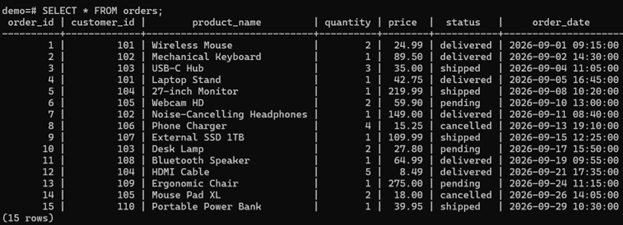
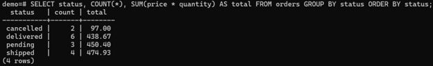
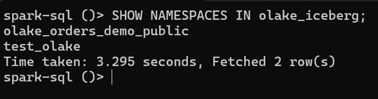
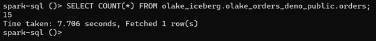
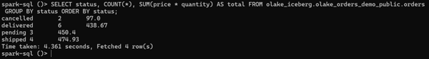

# OLake: Copy from Postgres to Apache Icerberg, query with Spark SQL.

Hello! Welcome to my tutorial on using the OLake pipeline. The purpose of this tutorial is to give you the instructions on how to properly set up a pipeline where you first develop a table in PostgreSQL, use OLake to transfer the schema to Apache Iceberg, and then query the copied data using Spark SQL.

Equipment/Software:
- Windows
- Docker Desktop
- PowerShell
- (note: while this tutorial focuses mainly on Windows, Linux/Mac users may adapt the given commands.)

Prerequisites:
- A running instance of Docker Desktop
- git
- Running ports:
- 5432
- 8000
- 8181
- 9000
- 9091
- 8888
- 8088
- 10000
- At least 8GB of RAM is recommended

If you'd like, you may use the 01_orders.sql and 02_bonus_changes.sql files to run as you work on the pipeline, though you are free to develop your own as well.

NOTE: All the credential names you see are my own throwaway values. They will likely not apply to your own project.

## Step 1: Setup Postgres
In PowerShell, as Docker is running, type:
- docker run -d --name olake-pg -e POSTGRES_PASSWORD=secret -e POSTGRES_DB=demo -p 5432:5432 postgres:16 -c wal_level=logical
'wal_level=logical' = A PostgreSQL setting that logs lower levels of metadata so that applications can parse table-level modifications into readable formats.

## Step 2: Create your table in SQL
In case you use the SQL file I gave you...
- docker cp 01_orders.sql olake-pg:/tmp/01_orders.sql
- docker exec olake-pg psql -U postgres -d demo -f /tmp/01_orders.sql

The actual queries:
- SELECT COUNT(*) FROM orders;
- SELECT status, COUNT(*), SUM(price * quantity) AS total FROM orders GROUP BY status ORDER BY status;

After developing your table, run some queries to ensure it works properly. For my table of orders, I got the count of rows, as well as a small table of each order status' count and total. (Remember these values for when we use Spark!)

(Note that in my table, the primary key (order_id) is used for upserts.)

## Step 3: Utilize OLake
Run:
- curl.exe -sSL -o docker-compose.yml https://raw.githubusercontent.com/datazip-inc/olake-ui/master/docker-compose-v1.yml
- docker compose -f docker-compose.yml up -d

(Note that if the official sources state a different type of command to use, I explain why I used curl.exe down in the 'Gotchas' section.)

Afterwards, go to the OLake UI at 'http://localhost:8000' (the site these commands will return) and login using 'admin' as the username, and 'password' as the password.

This is where your pipeline takes shape!

## Step 4: Initiate the catalog/MinIO/Spark
NOTE: Due to an unforseen error, several aspects of the 'docker-compose.yml' file images must be altered, or else the commands below will not function properly:
- minio: 
 - minio -> ifirestone/minio:RELEASE.2026-09-22T19-25-18Z
 - MINIO_ACCESS_KEY -> MINIO_ROOT_USER
 - MINIO_SECRET_KEY -> MINIO_ROOT_PASSWORD
- mc:
 - /usr/bin/mc -> mc
- rest:
 - rest -> apache/iceberg-rest-fixture
 - CATALOG_URI -> jdbc:sqlite:file:/tmp/catalog.db
 - (Delete the last two CATALOG_JDBC_* lines.)

Run:
- git clone https://github.com/datazip-inc/olake.git
- cd olake/examples/spark-tablurarest-minio-mysql
- docker compose up -d minio mc rest spark
(I have included 'Gotchas' concerning issues I had with pulling these images.)

You should see the following states for these names:
- minio: Up
- mc: Exited(0)
- iceberg-rest: Up
- olake-spark: Up

## Step 5: Create the source: 
In the UI, click on Sources -> Create Source -> Postgres.

In the following Source fields, enter the corresponding info:
- host: 'host.docker.internal'
- port: '5432'
- database: 'demo'
- user: 'postgres'
- password: 'secret'

## Step 6: Create the destination: 
In the UI, click on Destinations -> Apache Iceberg -> REST Catalog.

In the following Destination fields, enter the corresponding info:
- REST Catalog URL: 'http://host.docker.internal:8181'
- S3 Path: 's3://warehouse/orders/'
- S3 Endpoint: 'http://host.docker.internal:9000'
- AWS Region: 'us-east-1'
- Access Key: 'minio'
- Secret Key: 'minio123'

## Step 7: Create the job and discover the schema
Click on Jobs and create a name. Select the source and destination you created in Steps 5 and 6.
Ensure you tick the following:
- 'public.orders'
- Full Refresh
- Normalization on
- Upsert

Click on Create Job, then click on the three buttons on the side of said job to Sync Now. Wait until it is Completed.
The namespace I recieved from my project was:
- olake_orders_demo_public

## Step 8: Query with Spark
At last, it's time to use Spark! Run this in PowerShell:
- docker exec -it olake-spark /opt/spark/bin/spark-sql

Once spark-sql() is active, let's see if the data still holds up...
- SHOW NAMESPACES IN olake_iceberg;
- SELECT COUNT(*) FROM olake_iceberg.olake_orders_demo_public.orders;
- SELECT status, COUNT(*), SUM(price * quantity) AS total FROM olake_iceberg.olake_orders_demo_public.orders GROUP BY status ORDER BY status;

Your data should match up with the results of the queries you ran in your original demo. Mine sure did!

## That's all for the main queries...
But if you wish to update your table, such as by adding rows or adjusting values, you can also do that easily! We'll use this repo's 02_bonus_changes as a guide (the code within can be adjusted to fit your own work).

Back in postgres, run:
- 'docker cp 02_bonus_changes.sql olake-pg:/tmp/02_bonus_changes.sql'
- ' docker exec olake-pg psql -U postgres -d demo -f /tmp/02_bonus_changes.sql'

After that, run the commands from Step 1, and you should see your row count has increased, as well as the status data.

Within the UI, go to your job and Sync Now. Upon completion, return to Spark and run:
- SELECT order_id, status FROM olake_iceberg.olake_orders_demo_public.orders WHERE order_id IN (3, 6, 16, 17) ORDER BY order_id;

The data should have carried over again! If you were to check your row count using SparkSQL now, you should also see that it is the same amount as it was in your updated demo.

This concludes the major focus of this project. Congratulations on constructing your pipeline!

NOTE: To quit Docker and prevent your device from running slowly, run:
- wsl --shutdown

## Gotchas

1. 'curl -sSL' would return an error.
- 'curl' acted as an alias for 'Invoke-WebRequest,' which sends requests to web pages and returns their parsed content.
- I had to use 'curl.exe,' used to transfer data between computers and a remote server.

2. Certain SQL commands (like SHOW) would not be recognized.
- SQL would sometimes be typed directly into PowerShell by mistake.
- Either 'psql' or 'spark-sql' would need to be opened first.

3. An image pull had the chance to be stuck on the same spot indefinitly. 
- The download would be stalled for some reason.
- I would use Ctrl-C to clear the screen or even restart Docker entirely, then pull each image one at a time. This error wasted time and paused my workflow.

4. I would recieve 'unexpected EOF', followed by '500 Internal Server Error.'
- An image pull would be cut off mid-download.
- I would simply restart Docker Desktop and try the pull again.

5. 'exec /bin/sh: exec format error' when running the images for 'olakego/mc,' 'olakego/minio,' and 'ubuntu/mysql.'
- The true source of this error was not found. Both Docker and these images revealed that 'linux/amd64,' 'alpine,' and 'ubuntu' ran correctly. 
- I stopped using these specific images, and had to find another source. I currently do not know the root cause, but hope to find one soon. This one was especially annoying due to the fact that the images should have worked.

6. I recieved '401 Unauthorized' from trying to use 'quay.io/minio/minio,' and 'minio/minio' was missing from Docker. 
- MinIO had stopped distributing images.
- I had to resort to a community mirror: 'ifirestone/minio.'

7. My connection to 'http://host.docker.internal:8181' was refused.
- It turns out the REST catalog was not running.
- I would have to open 'https://localhost:8181/v1/namespaces' first.

8. The terminal could not find 'user iceberg'
- The 'tabulario/iceberg-rest' image was outdated/damaged.
- I had to utilize 'apache/iceberg-rest-fixture' with a SQLite catalog, and then use 'docker compose stop.'

9. The options for Change Data Capture were inaccessible.
- There was no replication slot present.
- I switched to using Full Refresh, as seen in this tutorial.

## To conclude...
Thank you for viewing this tutorial to the end! I hope you find OLake's resources useful, and continue to experiement with their work!

- https://olake.io/docs
- https://github.com/datazip-inc/olake
- https://iceberg.apache.org/docs/latest/
- https://spark.apache.org/docs/latest/
